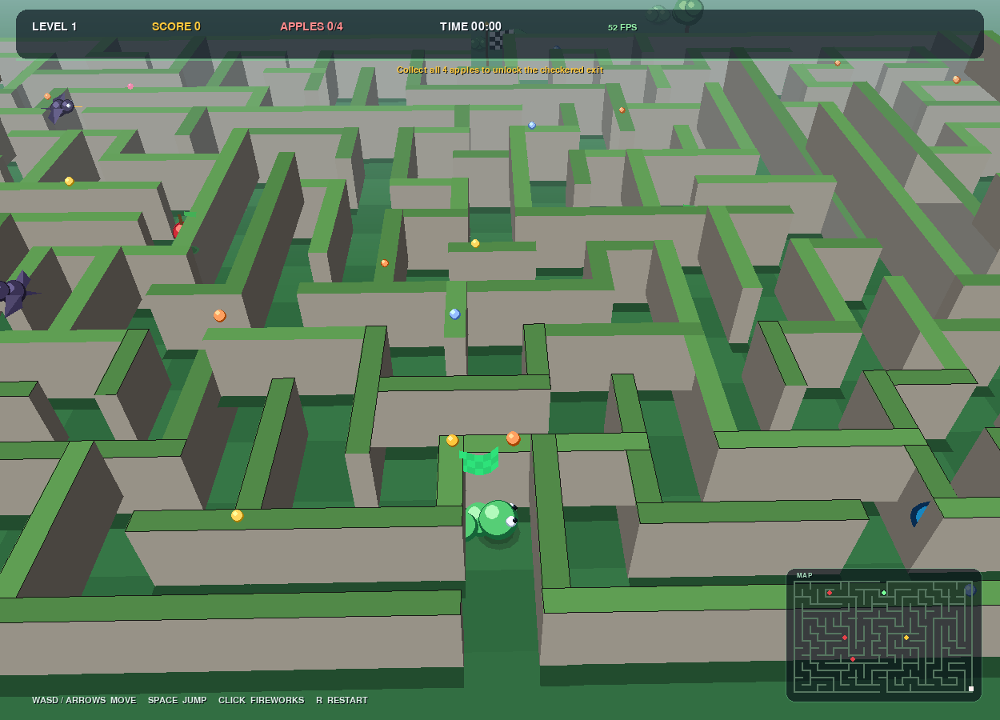

# Worm's Garden 3D

A single-file, software-rendered 3D remake of the 2D maze game, built on top
of `pygame` + `numpy` (no OpenGL).

## Rendering

The demo uses the **painter's algorithm**: polygons are projected to screen
space, depth-sorted back-to-front, and drawn with `pygame.draw` filled polygons.

## Requirements

- Python 3
- `numpy`
- `pygame`

Install dependencies:

```
pip install numpy pygame
```

## Run

```
python worm_garden_3d.py
```

## Preview



## Controls

| Key | Action |
| --- | --- |
| Arrow keys / WASD | Move the worm |
| Space | Jump |
| P | Toggle perspective / orthographic |
| F | Toggle depth fog |
| 1 / 2 / 3 | Switch camera view |
| F5 | Cycle quality preset |
